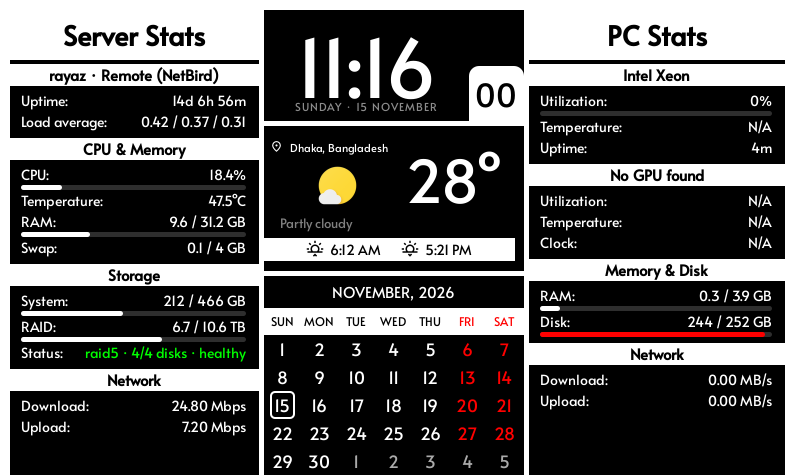

<div align="center">

# Stats Widget

**A desktop stats widget for Linux, built with [eww](https://github.com/elkowar/eww).**
Your home server, this PC, the clock, the weather and a calendar - on one panel (795 × 475 px by default, resizable).

[](LICENSE)




</div>

## Install - one line

```bash
curl -fsSL https://raw.githubusercontent.com/TechZeeLand/Stats-Widget/main/install.sh | bash -s -- --autostart --start
```

That detects your distribution, installs every dependency, builds [eww](https://github.com/elkowar/eww) if you do not have it
(about 10-20 minutes, once) and installs the widget. Run it as your normal user - it asks for `sudo` only for packages.

| Family | Distributions | Status |
|---|---|---|
| `fedora`  | Fedora, Nobara | tested by the author |
| `rhel`    | RHEL, AlmaLinux, Rocky, CentOS Stream, Oracle Linux 9/10 | community-tested wanted |
| `debian`  | Debian 12+, Ubuntu 22.04+, Mint, Pop!_OS, elementary, Zorin | package names verified on Ubuntu 24.04 |
| `arch`    | Arch, Manjaro, EndeavourOS, Garuda, CachyOS | community-tested wanted |
| `suse`    | openSUSE Tumbleweed / Leap, SLE | community-tested wanted |
| `generic` | everything else (you install the packages) | see [docs/INSTALL.md](docs/INSTALL.md) |

Prefer not to pipe to bash? `git clone https://github.com/TechZeeLand/Stats-Widget && cd Stats-Widget && ./install.sh` does the same.
Every installer lives in [`distros/`](distros) and is a few readable lines.

## What you get

| Column | Shows |
|---|---|
| **Server Stats** | hostname (or your own name) + which address is in use, uptime, CPU clock, CPU %, temperature, RAM, swap, system disk, **any number of storage pools with RAID health** (mdadm degraded / rebuilding), network speed - every row and path configurable |
| **Middle** | big clock with seconds and date, weather (Open-Meteo, no API key) with sunrise/sunset - hover for humidity, rain chance and wind - and a month calendar (your own week start and weekend) |
| **PC Stats** | this computer: CPU (name auto-detected, clock), temperature, uptime, GPU (AMD / NVIDIA / Intel; VRAM only when the card has its own), RAM, disk, battery, network - **every row can be switched off** |

* **Automatic failover** - uses `http://192.168.0.123/stats.php` at home; when that is unreachable it switches to
  `http://rayaz.netbird.cloud/stats.php`, and back again by itself. Fully configurable.
* **Settings window** - `stats-widget config`: server addresses (with a Test button), which server rows / storage pools to show, which **PC rows** to show, week start and weekend days, city search, 12/24 h, opacity, position and **size** (50-300 %, everything scales; or `stats-widget size 120%`).
* **Move it by dragging** - right-click the widget (or `stats-widget move`), drag the ghost, press Enter.
* **Server script** - [`server/stats.php`](server/stats.php) reports everything above and explains itself when something (like a RAID mount) can not be read: `stats.php?debug=1`.

## Everyday use

```text
stats-widget start | stop | restart | reload
stats-widget config            settings window
stats-widget move              drag the widget somewhere else (or right-click it)
stats-widget size 120%         resize (or 1000x600, or reset)
stats-widget autostart on|off  start with your desktop
stats-widget doctor            checks dependencies, fonts and your server addresses
stats-widget update [--full]   latest version, keeps your settings (not via dnf/apt/pacman: see docs/INSTALL.md)
stats-widget uninstall [--purge]
```

Settings live in `~/.config/stats-widget/config.toml` - see [docs/CONFIGURATION.md](docs/CONFIGURATION.md).

## Set up the server side

Put [`server/stats.php`](server/stats.php) on any web server with PHP 7.4+ - guide in
[docs/SERVER_SETUP.md](docs/SERVER_SETUP.md) (nginx / Apache / Docker, RAID permissions, security).

## Documentation

* [Installation](docs/INSTALL.md) · [Configuration](docs/CONFIGURATION.md) · [Server setup](docs/SERVER_SETUP.md) · [Troubleshooting](docs/TROUBLESHOOTING.md)
* [Contributing](CONTRIBUTING.md) · [Code of Conduct](CODE_OF_CONDUCT.md) · [Security policy](SECURITY.md) · [Changelog](CHANGELOG.md) · [Third-party notices](THIRD_PARTY.md)

## Privacy

The widget talks only to **your** stats.php addresses and to **open-meteo.com** (weather - it receives your configured
latitude/longitude, nothing else). There is no telemetry, no account, no tracking.

## License

Copyright (C) 2026 TechZeeLand and contributors.
Licensed under the **GNU Affero General Public License v3.0 or later** - see [LICENSE](LICENSE).
Bundled fonts and icons keep their own licenses: [THIRD_PARTY.md](THIRD_PARTY.md).
The widget started as a Rainmeter skin by TechZeeLand and was ported to eww.
